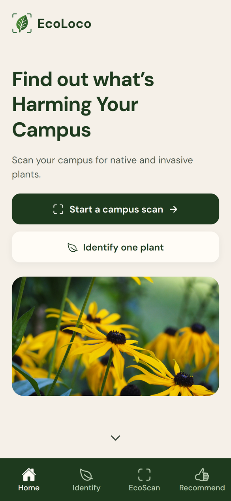
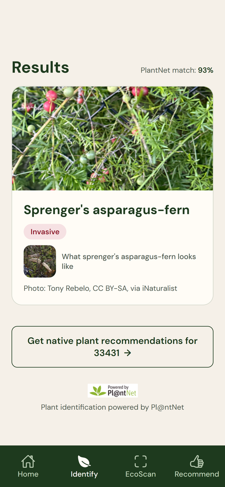
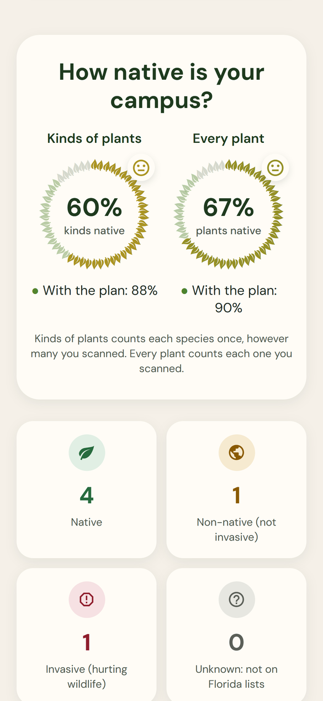
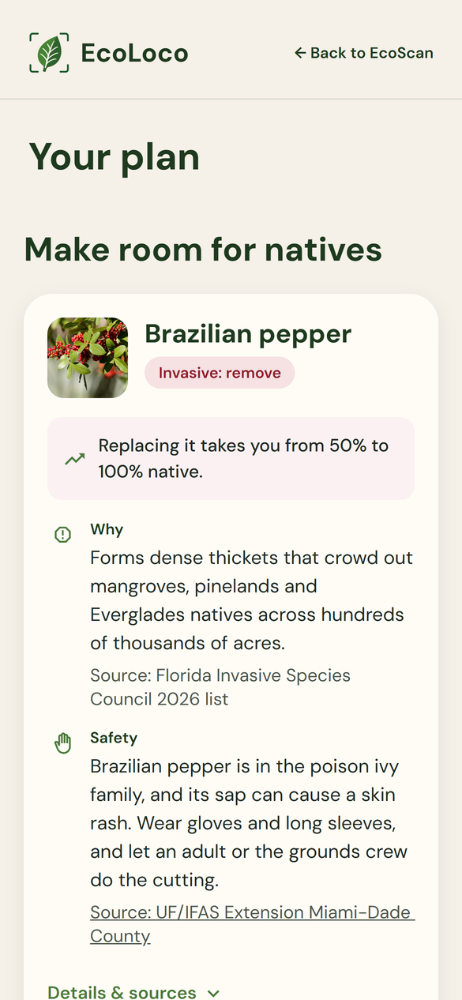
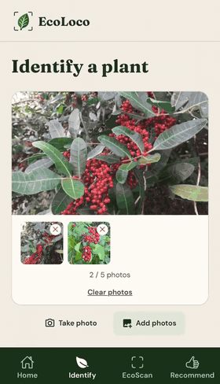
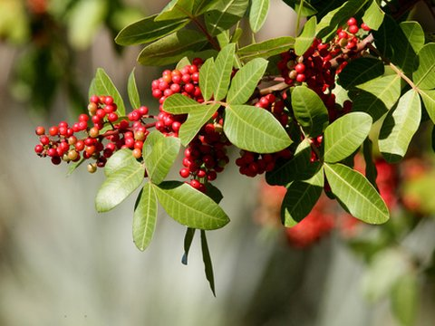
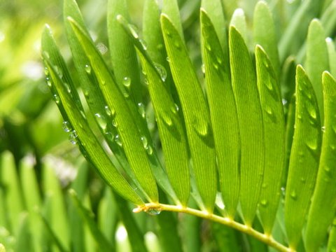
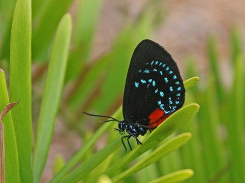
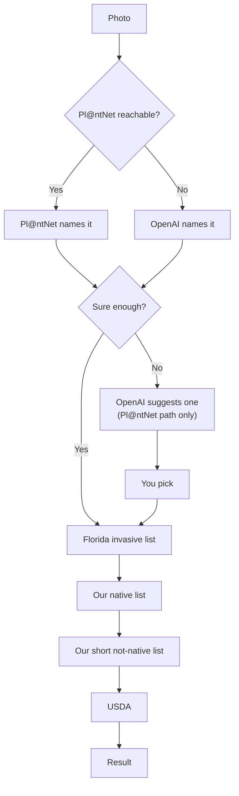

<p align="center">
  
</p>

<h1 align="center">EcoLoco</h1>

<p align="center">Find the plants hurting your campus, and plan which Florida natives to grow instead.</p>

<p align="center">
  <a href="https://github.com/Aydin-codes/EcoLoco-FL/actions/workflows/deploy-pages.yml"></a>
  
  
</p>

<p align="center">
  <a href="https://ecoloco.app"><b>Try it at ecoloco.app</b></a> ·
  <a href="https://www.youtube.com/watch?v=nDL3nJJa9II">Watch the demo</a> ·
  <a href="ARCHITECTURE.md">How it works</a> ·
  <a href="https://ecoloco.app/docs/architecture.html">Interactive code map</a>
</p>

<p align="center">
  
  
  
  
</p>
<p align="center"><sub>Home, identifying one plant, a campus scan's results, and the plan for removing an invasive plant. Screenshots from ecoloco.app at iPhone size.</sub></p>

<p align="center"></p>
<p align="center"><sub>A Brazilian pepper comes back invasive, a coontie comes back native, and the campus score updates. Recorded on an iPhone.</sub></p>

## What it is

EcoLoco is a phone app and website for Florida students. Scan the plants around your school and it tells you which ones are native, which are invasive, and where each answer comes from. Then it builds a plan to swap invasive plants for Florida natives and drafts a letter to your principal.

It's our entry for the 2026 Congressional App Challenge (FL-22). It started at the June 2026 USAII High School Hackathon as [HotCometGames/EcoLoco](https://github.com/HotCometGames/EcoLoco) and was rebuilt in October around real Florida plant data.

|  |  |  |
|:-:|:-:|:-:|
| **Brazilian pepper** is invasive. It forms thickets that crowd out mangroves, pinelands and Everglades natives. | **Coontie** is a Florida native on the list of plants EcoLoco suggests adding to a campus. | **The Atala butterfly** lays its eggs only on coontie. It was once thought extinct in Florida. |

## Features

- **Identify a plant**: take or upload up to 5 photos. Pl@ntNet names the plant, and EcoLoco says whether it's native, non-native or invasive in Florida.
- **Scan your campus**: add one card per plant, scan them all at once, and see what share of your campus is native, counted by kind of plant and by every plant.
- **Get a plan**: a removal card with safety notes for each invasive plant found, and native plants to add, checked for Palm Beach County.
- **Draft a letter**: an editable letter to your principal, built from your plan, with sources.
- **Save audits**: keep separate audits for different campuses on your device.
- **Every answer has a source**: the Florida Invasive Species Council 2026 list (179 plants), USDA PLANTS (5,322 Florida plants) and the USF Atlas of Florida Plants. AI never decides whether a plant is native or invasive.

## How it works

|  |  |  |  |
|:-:|:-:|:-:|:-:|
| **1. Photograph** a plant on campus | **2. Check** it against Florida's lists | **3. Plan** what to remove and what to plant | **4. Send** the letter to your principal |

Pl@ntNet, a plant identification AI, names the plant from your photos. If it isn't sure, you pick from its closest matches. Then EcoLoco checks the plant against Florida's lists in order and stops at the first one that knows it.

<details>
<summary><b>See every step of the check</b></summary>



</details>

The full picture, for readers who don't code and for developers, is in [ARCHITECTURE.md](ARCHITECTURE.md).

## Run it yourself

You'll need Node.js, Python 3, an OpenAI API key, and a free PlantNet API key from https://my.plantnet.org (without it, identification falls back to OpenAI only).

**Backend** (from the `backend` folder):
1. Create a file called `.env` with one key per line:
   ```
   OPENAI_API_KEY=your-openai-key
   PLANTNET_API_KEY=your-plantnet-key
   ```
2. Set up Python and install what it needs:
   ```
   py -m venv venv
   venv\Scripts\python -m pip install -r requirements-dev.txt
   ```
   On Mac or Linux, use `python3` instead of `py` and `venv/bin/python` instead of `venv\Scripts\python`.
3. Start the server: `venv\Scripts\python app.py`. It runs on port 5000. Debug mode is off by default; while developing, add `ECOLOCO_DEV=1` to `.env` to get automatic reloading and detailed error pages. Never turn it on for a demo or a public server. On a public server (like Render), start it with `gunicorn app:app --bind 0.0.0.0:$PORT` instead, and put the two keys in the host's environment settings, not in a `.env` file.

**App** (from the top folder):
1. Create a file called `.env` containing `EXPO_PUBLIC_API_URL=http://YOUR-COMPUTER-IP:5000`. If you're testing on a phone, use your computer's local network address, not `localhost`.
2. Run `npm install`, then `npx expo start`.
3. Scan the QR code with the Expo Go app, or press `w` to open it in a web browser.

**Tests**: from the `backend` folder, run `venv\Scripts\python -m pytest`. From the top folder, run `npm test`. The tests don't need any API keys and never call OpenAI, PlantNet or USDA. GitHub runs both on every pull request, and a pull request can't be merged unless they pass.

### Try it on your phone

Install the Expo Go app, run `npx expo start` from the top folder, and scan the QR code it prints. Your phone and computer need to be on the same Wi-Fi network.


<details>
<summary><b>Everything the app shows, in detail</b></summary>

**Inputs:**
- One to five photos of the same plant (a leaf, a flower, the bark), taken with the camera or uploaded, up to 10 MB each. More photos give a surer match.
- Your school's location: press "Use my location", or type an address or ZIP code. The app rounds your location to about 1 km before it leaves the phone and never saves it. Only Florida locations work; anywhere else gets a message saying so. Scanning and invasive checks work anywhere in Florida, but plants to add are only suggested in Palm Beach County, the one county our plant list was checked for. Elsewhere the app says "Planting recommendations are only checked for Palm Beach County so far."

If you already know the plant, you can skip the photos: press "Know its name? Choose by name" and start typing a common or scientific name. The list covers every plant the USDA PLANTS Database records in Florida. It shows names only; the plant's status is checked after you pick it, the same way as a scan, and the result says "Chosen by name" instead of a match percentage.

**Outputs for each plant:**
- Its name and how sure PlantNet is about the match
- When the app isn't sure, a short list of close matches to pick from ("Which one is it?"), each with its Florida status, a small chart of how PlantNet scored each one, which one OpenAI picks (only PlantNet's scores show numbers), plus a "None of these" button. Guesses PlantNet scored under 5% are left out
- When every close match has the same status (for example two native tickseeds), the app shows that status and "It's one of these:" with the names, instead of asking. You can still pick the exact one
- When the photo is too unclear to match anything, "Couldn't identify this. Try a close-up of one leaf, or a flower" instead of a guess
- Whether it's Native, Non-native, Invasive, or "Unknown: not on Florida lists"
- Where that verdict came from: the Florida invasive species list, our list of Florida natives, or the USDA plant database. The AI never decides this; if none of them know the plant, it stays unknown
- One line on why it matters (for example, coontie is the only plant the Atala butterfly can lay its eggs on), with where that line came from in small text underneath
- For plants in our data: which animals it helps and what to watch out for (for example, coontie seeds are poisonous to pets), each with its source, and a "See where it grows" button that opens that plant's USF Atlas page inside the app
- For invasive plants: how to remove them safely (Brazilian pepper is in the poison ivy family, so an adult should do the cutting)
- If the AI part is down, a small notice says "Extra descriptions are offline. Plant names and Florida status still work."

**After you scan a whole campus (the EcoScan tab):**
- The screen reminds you to only scan real plants growing outdoors. Press "Add plant" for each plant, give it up to 5 photos of that one plant (take them one at a time or upload several at once; on the website you can also drag photos onto the plant's card, and iPhone HEIC photos are turned into JPEGs first), then press "Scan all" to scan every plant together, or scan one card at a time. Ones the app isn't sure about show the same "Which one is it?" list, and any card can be removed with ✕. You can change the school's location at any time with "Change" next to the ZIP; the plants you scanned are kept.
- On the results screen, each plant has a Remove button for mistakes like a fake or potted plant. Removing one updates the counts, the percent, the charts, the plan and the letter.
- Plants are grouped as native, non-native (not invasive), invasive, and unknown. Only invasive plants count as hurting wildlife.
- How many plants are native, non-native, invasive, or unknown, and what percent of the identified ones are native, shown two ways: by kind of plant (each species counted once, however many times you scanned it) and by every plant you scanned
- What that percent would be with the plan: only invasive plants that have a ready replacement, and the native plants the plan adds, are counted
- Plants the app couldn't identify are still listed, but they aren't counted in the percent
- A plan: a "Remove" card for each invasive plant found, with a safety note and a native plant to replace it, and "Add" cards for native plants that fill gaps on your campus. Each card shows what the plant helps, where it grows, what to ask for at the nursery (and look-alikes to avoid), what to watch out for, and questions to look into, each fact with its source, plus a "See where it grows" button. Outside Palm Beach County you still get the Remove cards, but no Add cards
- Up to 5 plants to add at first, and a "Show all plants that fit" button for the rest. The extra plants start outside your letter; tick any you want in it
- Optional "Your site" choices (light, moisture, space and care) that narrow the plants to add, here and on the Recommend tab. Light and space use the sun and size we already checked. Moisture and care come from each plant's source page, and all 30 plants were checked for them. A plant whose moisture or care isn't checked is never hidden by them
- A link to plantrealflorida.org to find a native plant nursery
- Two simple charts: plants by status now and with the plan, and how many kinds of caterpillars each plant's group feeds (from the National Wildlife Federation)
- "Seen near you": the five plants people have photographed most within about 5 km of your school (from iNaturalist), each marked native, non-native, invasive or unknown, with a bar for how often it was seen. Natives that are common nearby grow well in your area; an invasive on the list could spread onto your campus
- A photo of each plant on the results, the plan cards and Identify, with the photographer's credit. The photos come from iNaturalist and are only used when their license allows it
- A short "Why this matters" section: four facts about native plants, birds, water and flooding, each with its source
- An "In my letter" checkbox on each plant to add. Untick one to leave it out of the letter and the "with the plan" numbers
- An editable letter to your principal listing the plants to remove and add, how to buy them, safety notes, the percent native now and with the plan (and the percent by kind of plant when it is different), and sources

**Saving separate audits:**

- At the bottom of the results screen, after the letter, enter a campus or place name and press **Save audit**. Then press **Start another audit** to check another place.
- Open **Saved audits** from EcoScan to reopen, rename, update or delete an audit. Each one keeps its plants, ZIP code, plan choices, results and edited letter. Changing one audit does not change another.
- Saved audits stay on this device after the app closes, and their results and letters open without a connection. Photos from the plant library may still need a connection. Changing the plan or writing a new letter needs the backend.
- Coordinates and original scan photos are not saved. On the web, audits stay in the current browser; clearing its site data removes them. An unfinished scan is kept only while the app is open.

</details>

<details>
<summary><b>Technical breakdown</b></summary>

1. **Identifying the plant.** The photos go to PlantNet, a plant identification service, which returns a ranked list of likely species with a score for each.
   - Different names for the same plant (for example "Zamia pumila" and "Zamia integrifolia", both coontie) are merged first, and their scores added together.
   - If PlantNet's top score is under 0.20, or it finds no plant at all, the app says it couldn't identify the photo.
   - If PlantNet is sure (top score 0.80 or higher, and clearly ahead of the next one), its answer is used.
   - In between, you pick from the close matches. OpenAI's image model (gpt-4o-mini) marks its pick in that list; it doesn't change PlantNet's scores, and only PlantNet's scores are shown as numbers. Guesses PlantNet scored under 5% are dropped first.
   - If PlantNet can't be reached, OpenAI identifies the plant from the photos on its own, using the same rules.
2. **Native or invasive.** Any name for the plant (scientific name, older name, or common name like "Florida arrowroot") is turned into one species first, so every spelling gets the same answer. Each invasive plant on the FISC list also carries the other names PlantNet, USDA and POWO use for it, so a plant PlantNet calls "Asparagus densiflorus" is still found as the FISC-listed Sprenger's asparagus-fern. Then it's checked in this order, and the first one that knows the plant wins:
   - the full official Florida Invasive Species Council (FISC) 2026 list of 179 invasive plants, which ships with the backend;
   - our own list of 21 South Florida natives, which also ships with the backend;
   - a short list of plants the USF Atlas says are not native to Florida (for now, tropical sage);
   - the USDA PLANTS database online, which says whether the plant is native to Florida or was brought in from somewhere else (answers are remembered while the server runs);
   - if none of them know it, the plant is shown as unknown.
3. **Facts about the plant.** Everything shown about a plant comes from our own data files, each fact with a link to where it came from (the Institute for Regional Conservation's Natives for Your Neighborhood, UF/IFAS, the ASPCA, or the FISC list). The AI doesn't write facts about plants. If we don't have facts for a plant, the app says so.
4. **Counting.** The app counts how many scanned plants are in each group and divides the natives by the plants it could identify. No AI is involved, and the name a plant was scanned under doesn't change the result: "Coontie", "coontie" and "Zamia integrifolia" all count the same. It also counts each kind of plant once, so two coonties and one Brazilian pepper are 67% native by plants but 50% by kinds. The "with the plan" percents only count changes the plan really makes: invasive plants that have a ready replacement, and the native plants it adds.
5. **The plan.** Plants to add come only from our list of about 30 South Florida natives. Each invasive plant found gets a replacement. The other picks fill gaps on campus: none of the plant groups that feed the most caterpillars here (from the National Wildlife Federation), nothing caterpillars eat, no fruit for birds, or months with nothing blooming. The first three picks include at most one tree and at least one easy plant. Plant-group counts like "Oaks feed 395 kinds of caterpillars here" are always for the whole group, and are never added together.
6. **Your location.** A typed address or ZIP, or your rounded location, is turned into a ZIP code using OpenStreetMap's free Nominatim service (no more than one request a second, as its rules ask). The ZIP's county comes from a table of every Florida ZIP code built from the 2020 Census; a ZIP the table doesn't know (like a PO box) is treated as outside Palm Beach County. The same rounded location is used to ask iNaturalist which plants have been seen nearby. Neither is stored.
7. **The letter.** The letter is built from the plan. OpenAI may only reword the opening paragraph, and its version is thrown away if it adds a plant or animal name, or changes a number. Without OpenAI, the letter still works.

The invasive list is generated straight from the official FISC PDF by a script in `backend/scripts/`, so it matches the published list.

**How the recommended plants were checked.** Each of the 30 plants the app can recommend was looked up by hand in the USF Atlas of Florida Plants (https://florida.plantatlas.usf.edu) to confirm it's native to Palm Beach County, and its facts and its "replaces" pairing were checked against their sources. Who checked each plant, and when, is recorded in `docs/plant-checklist-verified.csv`. A plant that hasn't passed this check is never recommended. Tropical sage was taken off the list after its Atlas page showed it isn't native.

</details>

<details>
<summary><b>Finding your way around the repo</b></summary>

| Folder | What's in it |
|---|---|
| `frontend/` | The phone app and website. `screens/` has one file per screen, `components/` has pieces shared between screens, and `services/` sends requests to the backend. Colors, fonts and text sizes live in `theme.js`: colors taken from Florida native plants, and DM Sans for text. |
| `backend/` | The Python server the app talks to. `app.py` lists the web addresses the app can call, `services/` does the work (identifying, Florida status, counting, the plan, the letter), and `data/` holds the Florida plant lists with their sources. `scripts/` rebuilds those lists from the original sources (see below), and `tests/` checks it all works. |
| `assets/` | The app icon, splash screen, images, the leaf animation shown while scanning, and the official "Powered by Pl@ntNet" logo. |
| `docs/` | The interactive architecture map (`architecture.html`) and the checklists showing how each recommended plant was checked. |
| `tests/` | Tests for saved audits. |

`ARCHITECTURE.md` is the written version of the architecture map, with a glossary.

**The architecture map:** open https://ecoloco.app/docs/architecture.html, or double-click `docs/architecture.html` in a copy of the repo. Click any box to see what that part of the code does, step by step, and which parts it connects to. The buttons along the top (Identify, Recommend/Plan, Audit, Location) show only the parts one feature uses.

</details>

<details>
<summary><b>Rebuilding the plant data from its sources</b></summary>

Each list in `backend/data/` that comes from an outside source can be rebuilt from it, so anyone can check it. Run these from the `backend` folder after installing `requirements-dev.txt`:

| Data | Source | Command |
|---|---|---|
| Florida invasive list | FISC 2026 PDF | `venv\Scripts\python scripts/build_fisc_list.py <link to the FISC PDF> data/fisc_list.json` |
| Florida plant names | USDA PLANTS | `venv\Scripts\python scripts/build_fl_plant_names.py download data/fl_plant_names.json` |
| ZIP code to county | 2020 Census | `venv\Scripts\python scripts/build_zip_counties.py https://www2.census.gov/geo/docs/maps-data/data/rel2020/zcta520/tab20_zcta520_county20_natl.txt data/fl_zip_counties.json` |
| Plant photos and credits | iNaturalist | `venv\Scripts\python scripts/build_plant_photos.py data/plant_photos.json` |

**Phone layout in a desktop browser:** with Expo running on port 8081 (`npx expo start --web --port 8081`), run `npm run preview:phone` in another terminal and open http://localhost:8002. It shows the live app in a 390 × 844 phone-sized window. It's a web preview, not an iOS or Android simulator.

</details>

## Built with

| | | What it does in EcoLoco |
|:-:|---|---|
|  | [React Native](https://reactnative.dev) | One codebase for the phone app and the website |
| <picture><source media="(prefers-color-scheme: dark)" srcset="assets/readme/logos/expo-dark.svg"></picture> | [Expo](https://expo.dev) | Runs the app on phones through Expo Go and builds the website |
|  | JavaScript | The app's code |
|  | Python | The backend's code |
| <picture><source media="(prefers-color-scheme: dark)" srcset="assets/readme/logos/flask-dark.svg"></picture> | [Flask](https://flask.palletsprojects.com) | The small web server the app sends photos and questions to |
| <picture><source media="(prefers-color-scheme: dark)" srcset="assets/powered-by-plantnet-dark.png"></picture> | [Pl@ntNet](https://plantnet.org) | Names the plant in your photos |
| <picture><source media="(prefers-color-scheme: dark)" srcset="assets/readme/logos/openai-dark.png"></picture> | [OpenAI](https://openai.com) | A backup when Pl@ntNet can't be reached, a second opinion on unsure matches, and rewording the letter's first paragraph. It never decides whether a plant is native or invasive |
|  | [GitHub Actions](https://github.com/features/actions) | Runs all the tests on every change, and publishes the website when they pass |
|  | [Cloudflare Pages](https://pages.cloudflare.com) | Hosts the website at ecoloco.app |
| <picture><source media="(prefers-color-scheme: dark)" srcset="assets/readme/logos/render-dark.svg"></picture> | [Render](https://render.com) | Hosts the backend |

**Where the plant facts come from:**

| Question | Source |
|---|---|
| Is it invasive in Florida? | [Florida Invasive Species Council](https://www.floridainvasives.org) 2026 list, 179 plants |
| Is it native to Florida? | Our list of 21 South Florida natives, then [USDA PLANTS](https://plants.usda.gov) (5,322 Florida plants) |
| Does it grow in Palm Beach County? | [USF Atlas of Florida Plants](https://florida.plantatlas.usf.edu) |
| What does it help, and how do you grow it? | [Natives for Your Neighborhood](https://www.regionalconservation.org/beta/nfyn/) from the Institute for Regional Conservation, and [UF/IFAS](https://gardeningsolutions.ifas.ufl.edu) |
| Which plants feed the most caterpillars? | [National Wildlife Federation](https://www.nwf.org/Garden-for-Wildlife/About/Native-Plants/keystone-plants-by-ecoregion) keystone plants for South Florida |
| Is it safe around pets? | [ASPCA](https://www.aspca.org/pet-care/animal-poison-control/toxic-and-non-toxic-plants) |
| What grows near your school? | [iNaturalist](https://www.inaturalist.org), within about 5 km |
| Where is your school? | [OpenStreetMap](https://www.openstreetmap.org) and the 2020 Census |

## Current limits

- Plants to add are only suggested in Palm Beach County, the one county our plant list was checked for. Scanning and invasive checks work anywhere in Florida.
- Our own native list covers 21 South Florida plants. A plant that isn't on our lists or Florida's invasive list is checked against USDA PLANTS, and if USDA doesn't know it (or can't be reached), it's shown as unknown instead of guessed.
- The phone version runs through the Expo Go app. The website works on any phone or computer.
- Saved audits stay on the device or browser they were made on.

<p align="center"></p>

## License

MIT. See [LICENSE](LICENSE).

<sub>Photos from iNaturalist: Brazilian pepper (c) Mary Keim, CC BY-NC-SA; coontie (c) Jenny Evans, CC BY-NC; Atala butterfly (c) Eridan Xharahi, CC BY. Icons from Microsoft Fluent Emoji and [Simple Icons](https://simpleicons.org). Bunny comic by [Chibird](https://chibird.com).</sub>
